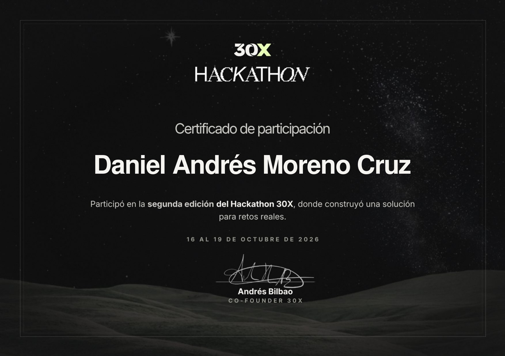
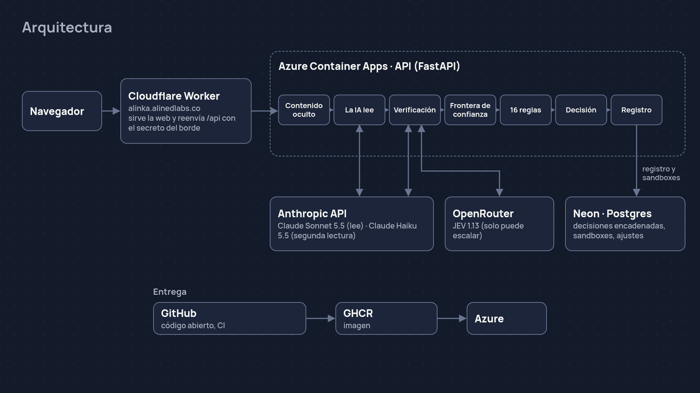
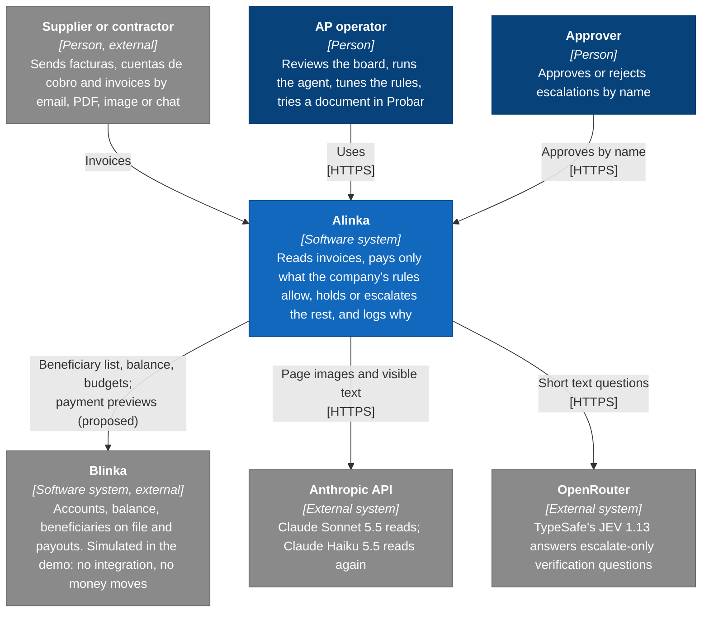
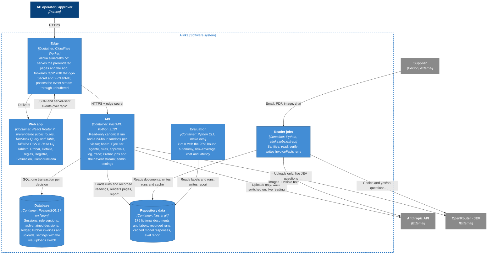
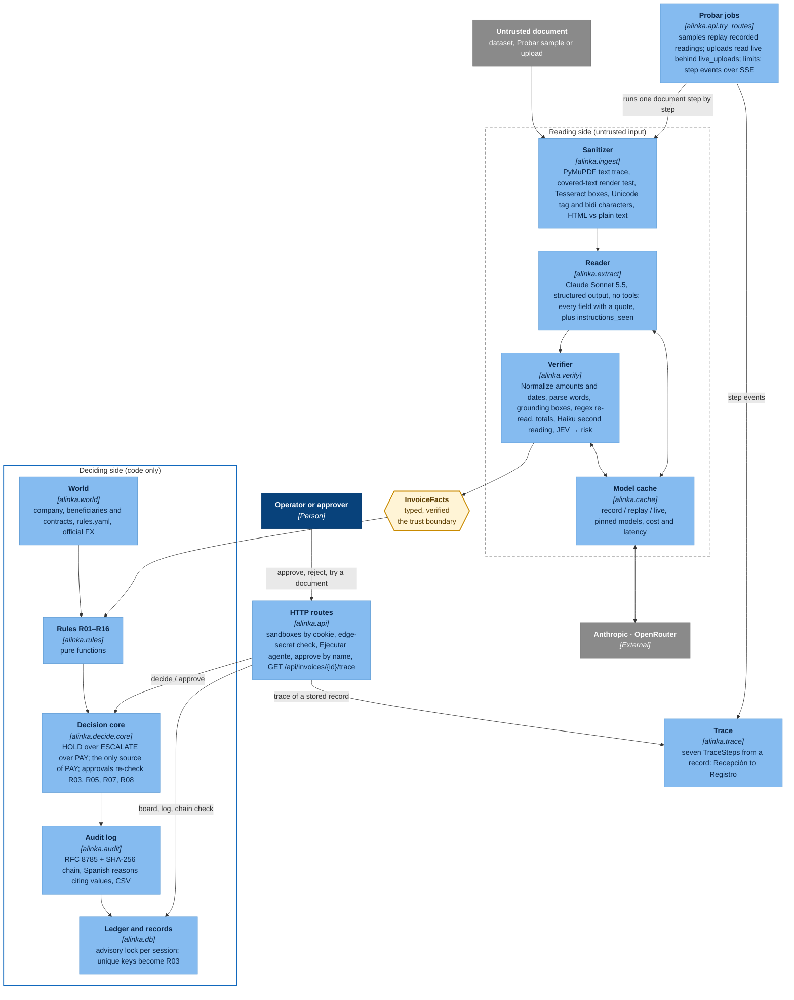
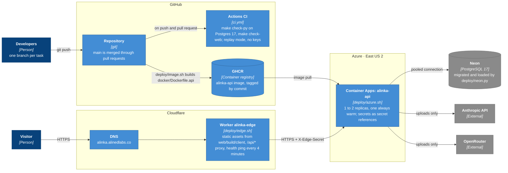

# Alinka

An accounts-payable agent for the Blinka challenge (HackRadar 30X). It reads invoices that arrive by email, PDF, image or chat, pays only what the company's rules allow, holds or escalates the rest with a reason, and keeps a log anyone can read.

**La IA lee, las reglas deciden, el registro explica.** The AI reads, the rules decide, the log explains.

**Live demo, frozen: <https://alinka.alinedlabs.co>** (fictional data; the app is in Spanish, with an English summary at [/en](https://alinka.alinedlabs.co/en)).

## Project status: closed

The hackathon is over, and on 22 October 2026 Alinka was closed for good. The site stays up as a frozen demo, served by Cloudflare alone:

- **The showcase page** at [`/`](https://alinka.alinedlabs.co) (Spanish) and [`/en`](https://alinka.alinedlabs.co/en) (English) sums up what Alinka is and what the evaluation measured. The Tablero moved from `/` to [`/tablero`](https://alinka.alinedlabs.co/tablero).
- **The API was retired.** Its Azure Container App and Neon database are no longer used, and no model is called any more. The Cloudflare Worker (`edge/`) now answers `/api/*` from responses recorded from the live API just before it was retired (`web/public/snapshot/`, recorded by `web/scripts/snapshot.ts`).
- **What still works:** browsing every screen, "Ejecutar agente" and "Restablecer sandbox", every invoice with its page image and decision trace, "Verificar cadena", the CSV export, Evaluación and Probar's samples. Editing rules, adding beneficiaries, approving, rejecting and uploading answer with a message that the demo is frozen.
- **The canonical run is pinned.** Its chain head at the freeze is `5b5379070e12b29a8dcd4f70ec76df1e30248604c4a758be24b56c97cd77002b`, recorded at 08:53 UTC; the frozen `/api/health` serves it.
- **Everything still runs locally.** The FastAPI service, the evaluation and the tests work in replay mode with no keys, as described in [Reproduce in replay mode](#reproduce-in-replay-mode).

The architecture and deployment below describe Alinka as it ran live, from 18 to 22 October 2026.

## Participation certificate

Alinka was built for the Blinka challenge in the second edition of the 30X Hackathon, held from 16 to 19 October 2026. The certificate of participation is below; the image links to [the original PDF](docs/certificado-participacion-30x.pdf).

[](docs/certificado-participacion-30x.pdf)

## Architecture



**The AI reads, the rules decide, the log explains.** A model reads each document on the untrusted side: it gets page images and code-built visible text, no tools, and never the rules, the beneficiary list or the ledger. Its reading is checked in code and by second readers, and only typed, verified `InvoiceFacts` cross the trust boundary. On the other side sixteen pure rules and one decision core decide, the payout account comes from the beneficiary list, and every decision is written to a hash-chained log with its reason in Spanish. A model mistake can cost a review, never a payment. The diagrams below are C4; [docs/architecture.md](docs/architecture.md) has the same four with notes.

### Context

Alinka sits between the suppliers who send invoices and the company's payment platform, which the demo simulates: it proposes payments to accounts already on file and moves no money. The only outside services are the models: Claude through the Anthropic API, and TypeSafe's JEV through OpenRouter.



### Containers

One origin, `alinka.alinedlabs.co`: a Cloudflare Worker serves the prerendered web app and forwards `/api/*` to the FastAPI service, passing Probar's event stream through unbuffered. Reading runs as batch jobs whose recordings the API, the evaluation and the tests replay, so none of them needs model keys; only Probar uploads, behind the `live_uploads` switch, call the models from the API.



### Components

The pipeline of one invoice. Sanitizer, reader and verifier sit on the untrusted side, and every model call goes through the cache. Rules, decision core and audit log are code only. `alinka.trace` rebuilds the seven steps of any stored decision for Probar and "Cómo se decidió".



### Deployment

As it ran until 22 October 2026; since then only Cloudflare serves the site (see [Project status](#project-status-closed)). CI checks every push in replay mode with no keys. The API image goes to GHCR and runs on Azure Container Apps in East US 2, with one replica always warm and its secrets held as secret references; the database is Neon, and Cloudflare serves the domain and the Worker.



### Platforms and libraries

| | What it does in Alinka | Where |
| --- | --- | --- |
| Anthropic API (`anthropic`) | Claude Sonnet 5.5 reads each document; Claude Haiku 5.5 reads it again to check | `alinka/extract/claude.py`, `alinka/verify/`, `alinka/cache.py` |
| OpenRouter, TypeSafe's JEV 1.13 | Escalate-only verification questions on the reading | `alinka/verify/jev.py` |
| Cloudflare | DNS for `alinka.alinedlabs.co`; the Worker serves the app and proxies `/api/*` with the edge secret | `edge/`, `deploy/edge.sh` |
| Azure Container Apps | Runs the API container | `deploy/azure.sh`, `docker/Dockerfile.api` |
| Neon | Managed PostgreSQL 17 | `deploy/neon.py`, `migrations/` |
| GitHub, Actions and GHCR | Repository and pull requests; CI on every push; the API image registry | `.github/workflows/ci.yml`, `deploy/image.sh` |
| PyMuPDF | PDF text trace, hidden-text checks and page images | `alinka/ingest/pdf.py`, `alinka/api/pages.py` |
| Tesseract (`pytesseract`, Pillow) | OCR boxes for photos and scans | `alinka/ingest/image.py` |
| FastAPI, Uvicorn | The HTTP API, the Probar jobs and their event stream | `alinka/api/` |
| Pydantic, pydantic-settings | The shared typed contract and settings from the environment | `alinka/types.py`, `alinka/settings.py` |
| psycopg, psycopg-pool | Postgres access, one transaction per decision | `alinka/db.py` |
| rfc8785 | Canonical JSON bytes for the SHA-256 chain | `alinka/audit/chain.py` |
| React Router 7 | The web app, with the public routes prerendered | `web/app/routes.ts`, `web/react-router.config.ts` |
| Tailwind CSS 4 | The design system's styles | `web/app/styles/` |
| Base UI | Dialogs and controls | `web/app/components/` |
| TanStack Query and Table | Server state; the board table | `web/app/routes/`, `web/app/components/board-table.tsx` |
| openapi-typescript, openapi-fetch | Types and a typed client generated from `openapi.json` | `web/app/api/` |
| Playwright | End-to-end tests on the live site; renders the Open Graph image | `tests/e2e/`, `web/scripts/og.ts` |
| WeasyPrint, Jinja2, Faker, num2words, segno | Generate the fictional dataset: documents, words for amounts, QR codes | `data/generator/` |
| pytest, Hypothesis, Ruff, Vitest | Tests and lint behind `make check` | `tests/`, `web/app/**/*.test.ts` |
| uv, pnpm | Python and JavaScript environments, locked | `pyproject.toml`, `uv.lock`, `pnpm-workspace.yaml` |

### How it was built

Planned and researched with Claude, and built in one day by Daniel Andrés Moreno Cruz (Alined Labs) directing six Claude Code sessions on Claude Opus 5.5 across four machines, one session per lane:

- **A:** the core, the rules and the evaluation.
- **B:** the dataset, then Probar's front end and the motion graphics.
- **C:** reading and verification, then Probar's API.
- **D:** the API, the database, SEO and the docs.
- **E:** the front end.
- **P:** deployment and QA.

The sessions coordinated through a private repository where each one logs what it starts and finishes. A merge queue checked every branch (Conventional Commits, a secret scan, frozen contracts, `make check`) and merged it through a pull request. Context7 supplied current library documentation, the Chrome DevTools MCP checked every page, and the design system was built from Mobbin references.

## The problem

A US company paying contractors in Latin America receives facturas, cuentas de cobro and invoices in four channels and three currencies. Every one has to be checked against the beneficiary list, the contract, caps, budgets and duplicates, and some are written to fool whoever reads them. Alinka does the reading with a model and everything else in code, so a model mistake costs a review, never a payment.

## Guarantees

- **Only the decision core returns PAY** (`alinka/decide/core.py`). Sixteen deterministic rules run on every invoice; HOLD beats ESCALATE beats PAY.
- **Doubt escalates.** Any exception, refusal, truncation, timeout or validation error becomes "Pendiente de aprobación". Verifiers (a second reading, JEV) can only raise risk.
- **The payout account comes from the beneficiary list**, never from the document.
- **The reader is quarantined.** It gets page images and code-built visible text, no tools, never the rules, the list or the ledger. Hidden text, Unicode controls and HTML/plain-text mismatches are caught in code before it reads.
- **Every decision is explained and chained.** Each reason names its rule in Spanish with the values it used; records are RFC 8785 bytes in a SHA-256 chain that "Verificar cadena" recomputes from storage.
- **Approvals are bounded.** Only escalations, only by name, never when R01 (beneficiary) or R12 (bank account) fired, and caps (R03, R05, R07, R08) are re-checked at that moment.

## Probar

[Probar](https://alinka.alinedlabs.co/probar) runs one document through the real pipeline in your sandbox and shows each of the seven steps as it happens: Recepción, Contenido oculto, La IA lee, Verificación, 16 reglas, Decisión and Registro, each with its real duration.

- **Samples** (routine invoices, traps and attacks from the dataset) replay the recorded model readings, shown as "Lectura grabada". Everything after the reading runs live: the sanitizer, the checks, the 16 rules, the decision and the chained log. No keys are needed. Until the freeze the new invoice landed on your sandbox board; in the frozen demo a sample's run is a recording and its invoice no longer joins the board.
- **Uploads** are off for good since the freeze. Until then they were read live by the models ("Lectura en vivo") only while an administrator had switched them on; they were off by default. Limits: PDF, PNG or JPG, 4 MB, 3 pages, 5 uploads per 10 minutes and 30 a day per client IP, 200 a day in total. Files and results are deleted with the sandbox after 24 hours. Upload only fictitious invoices.

## Results

Every number below is in [`evals/report.json`](evals/report.json) (summary in [EVAL_REPORT.md](EVAL_REPORT.md)), produced by `make eval` in replay on Lane C's recorded run `data/runs/all-jev-on`: 175 invoices, the October month (30), the generated evaluation set (120) and the hand-written attacks (25).

| | All 175 | October month (30) | Attacks (25) |
| --- | --- | --- | --- |
| Improper approvals, k of K | **0 of 85** | 0 of 14 | 0 of 23 |
| One-sided 95% upper bound (Clopper–Pearson) | **3.5%** | 19.3% | 12.2% |
| Decided without a person (Pagada or Frenada) | 124 (70.9%) | 23 (76.7%) | 10 (40.0%) |
| Possible ceiling (gold is not Pendiente) | 137 (78.3%) | 23 (76.7%) | 10 (40.0%) |

- **Autonomy: 71% of a possible 78%.** Every invoice decided without a person was decided as gold says; the month and the attacks reach their ceiling.
- **Every disagreement with gold is more cautious:** the 13 are invoices gold would pay that went to a person on reading doubt. Decision accuracy is 92.6%; no PAY happened where gold says otherwise.
- **Security alerts on 13 of 13** attacks that call for one.
- **Field accuracy 98.5%** of 1,912 critical fields: PDF 99.8%, email 100%, chat 99.1%, image 87.6%; English 100%, Spanish 97.6%.
- **Cost 0.023 USD per invoice; latency p50 11.4 s, p95 16.4 s** per invoice.
- **Risk–coverage.** The curve with JEV on and off is in the report. Its best threshold with JEV on (0.9) decides one more invoice than 0.7 and rests on that single case, so `data/rules.yaml` keeps `verifier_risk_max` at 0.7, which is also the pick with JEV off.

## Threat model

| Attack | Defence |
| --- | --- |
| Hidden or white text, tiny or off-page text, layers, annotations, metadata telling the system to pay | Code finds it in the PDF text trace before reading (R11, security alert); the model never sees it as visible text |
| Instructions the reader notices | Reported as `instructions_seen`, never followed, and they escalate (R11) |
| Zero-width, bidi or tag characters in chats and emails; HTML that differs from the plain text | Flagged in code (R11) |
| A changed bank account on the document | The payout uses the list's account; any differing account escalates with no approve button (R12) |
| Look-alike or impersonated beneficiaries | Name similarity, tax ID ownership and mixed scripts (R01, "posible suplantación"), no approve button |
| Duplicates, split invoices, cap and budget pressure | R03, R13, R05, R07, R08, enforced again on approval; the database's unique keys make a concurrent duplicate an R03 hold |
| Words that differ from the digits, amounts near a threshold, FX games | R15, R06 with a 5% band, official rates at most 4 days old |
| Direct calls to the API | Until the freeze, the Worker added `X-Edge-Secret`, and without it every route but `/api/health` was refused. Since then there is no API to call: the Worker replays recordings |

## API

Every route is under `/api`. Since the freeze the Worker answers them from the recorded snapshot (`edge/src/frozen.ts`), and every route that writes answers 403. Against the FastAPI service, sandbox routes are scoped by the `alinka_sandbox` cookie; `?view=canonical` reads the read-only canonical run instead. Errors are `{"detail": "<Spanish message>"}`. The full schema is in [`openapi.json`](openapi.json).

| Route | What it does |
| --- | --- |
| `GET /api/health` | Status and `canonical_head`, the head hash of the canonical run |
| `GET /api/board` | The board: Pagada, Frenada and Pendiente de aprobación, security alerts first |
| `POST /api/run` | "Ejecutar agente": decide the inbox in received order |
| `GET /api/invoices/{id}` | One invoice: fields with quotes and boxes, the 16 rule results, the record |
| `GET /api/invoices/{id}/pages/{n}?scale=1\|2\|3` | Page *n* as a PNG at 150, 300 or 450 dpi (default 1) |
| `GET /api/invoices/{id}/trace` | The seven Probar steps rebuilt from the stored record; 404 if unknown or undecided |
| `POST /api/invoices/{id}/approve`, `/reject` | Approve an escalation by name, with the caps checked again, or reject it |
| `GET /api/rules`, `PUT /api/rules` | Read or edit the sandbox's rules; saving re-decides the sandbox |
| `POST /api/beneficiaries` | Add a beneficiary to the sandbox's list (the way out of R01), then re-decide |
| `POST /api/sandbox/reset` | A fresh sandbox copied from the canonical run, under the same cookie |
| `GET /api/log`, `GET /api/log/verify` | The chained log and "Verificar cadena", recomputed from storage |
| `GET /api/log/export.csv` | The log as CSV, one row per decision with its reason |
| `GET /api/eval` | The evaluation report shown on Evaluación |
| `GET /api/try/samples` | Probar's samples, whether uploads are on, and the upload limits |
| `POST /api/try` | Start a run: JSON `{"sample_id"}`, or a multipart `file` while uploads are on; 202 with `job_id` and `events_url` |
| `GET /api/try/{job_id}/events` | Server-sent events: `step` (each step running, then its result), then `done` with the Detalle link, or `error`; replayed from the start for late subscribers |
| `PUT /api/admin/settings` | Switch live uploads on or off with `Authorization: Bearer <ADMIN_TOKEN>`; absent while no token is set |

## Reproduce in replay mode

No model keys are needed: every model call is recorded in `cache/responses/` and every reading in `data/runs/`.

```bash
make setup                    # git hooks, uv sync --frozen
make db-up                    # Postgres 17 in Docker
uv run python -m alinka.db migrate
uv run python -m alinka.api.load_run showcase   # prints the canonical head hash
make eval                     # evals/report.json and EVAL_REPORT.md; exits 1 on any improper approval
make check                    # ruff, pytest (API tests on a real Postgres), web checks
make api                      # http://localhost:8000/api/health
make web                      # the seven screens, proxying /api
```

## Canonical run

The board judges see first is the October month (`data/runs/showcase`), loaded as a read-only canonical session. `uv run python -m alinka.api.load_run showcase` decides it in received order and prints the head hash of its chain; the deployed API serves the same hash as `canonical_head` at `/api/health`. Records carry the time they were decided, so every load has its own head; "Verificar cadena" recomputes it from the stored bytes.

## Licence

Code: [GNU AGPL-3.0](LICENSE). Dataset (`data/`): [CC BY 4.0](data/LICENSE). All data is fictional; see [data/DATASHEET.md](data/DATASHEET.md) and [LIMITATIONS.md](LIMITATIONS.md).
