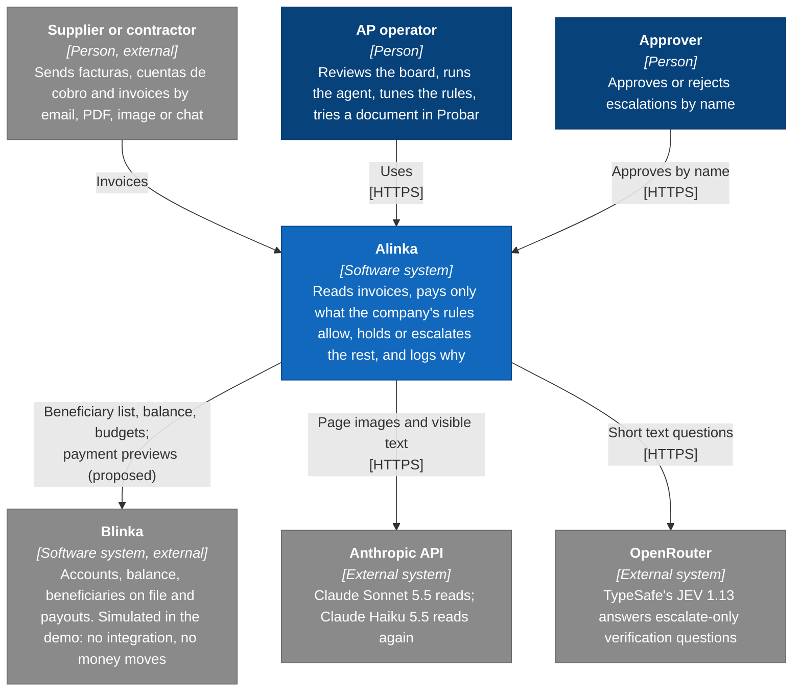
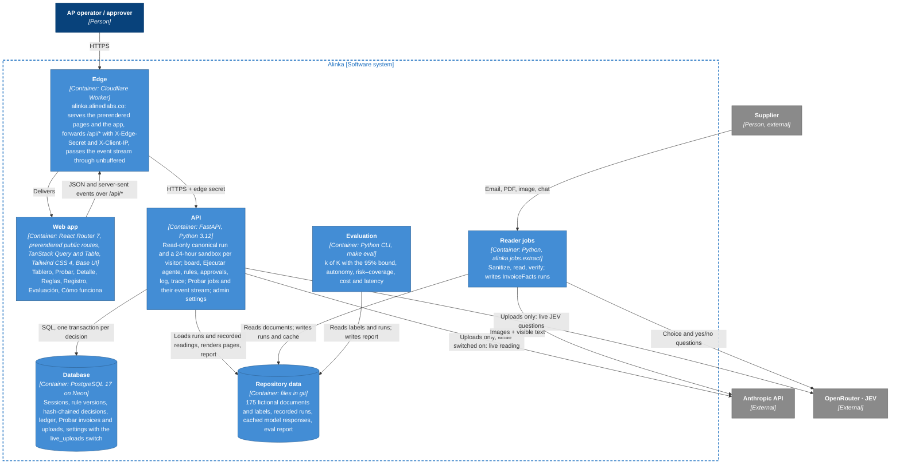
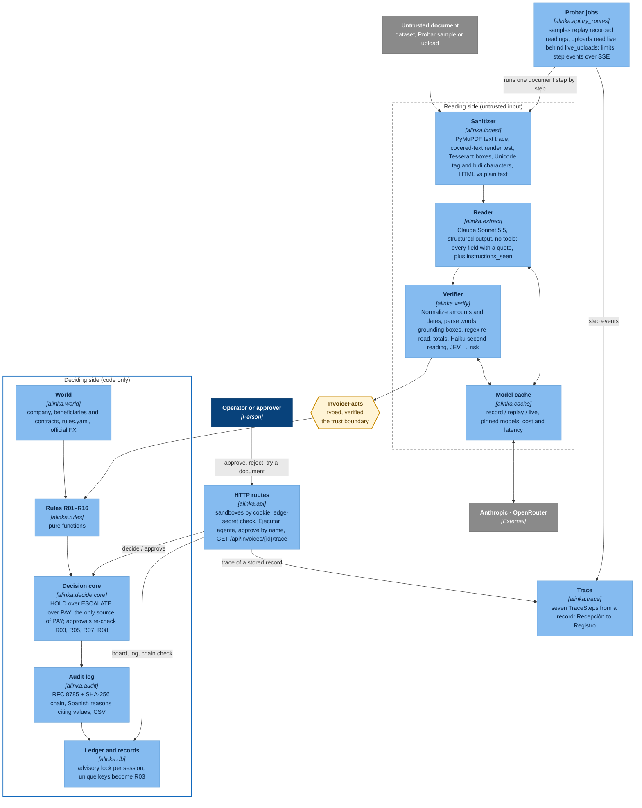
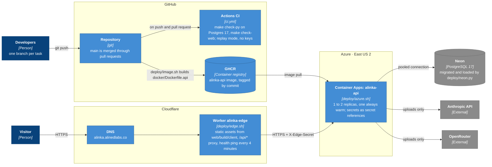

# Architecture (C4)

Alinka in four diagrams: the system in its context, the containers inside it, the components of the decision pipeline, and the deployment. The line that matters is the **trust boundary**: only typed `InvoiceFacts` cross from the reading side into the rules, and only the decision core can return PAY.

Legend: dark blue = person, blue = Alinka, light blue = component, grey = external. Solid arrows are calls or data flow; the trust boundary is the dashed box.

## Level 1 · System context

## Level 2 · Containers

## Level 3 · Components of the decision pipeline

## Level 4 · Deployment

**What the diagrams show**
- **Context:** Alinka sits between suppliers and the company's payment platform. It proposes payments to accounts already on file and moves no money.
- **Containers:** one origin, `alinka.alinedlabs.co`; the Worker joins the prerendered app and the API and lets Probar's event stream through unbuffered. Reading runs as batch jobs whose recordings everything else replays, so the API and the tests need no model keys; only Probar uploads, behind the `live_uploads` switch, call the models from the API.
- **Components:** the model sits on the untrusted side and has no tools. Verification can only raise the risk. Sixteen pure rules and one decision core decide, the log explains every decision in Spanish, and `alinka.trace` rebuilds the seven steps of any decision for Probar and "Cómo se decidió".
- **Deployment:** CI checks every push in replay mode. `deploy/image.sh` pushes the API image to GHCR, `deploy/azure.sh` rolls it out to Azure Container Apps with secrets held as secret references, `deploy/neon.py` migrates Neon and loads the canonical run, and `deploy/edge.sh` publishes the Worker on Cloudflare.
