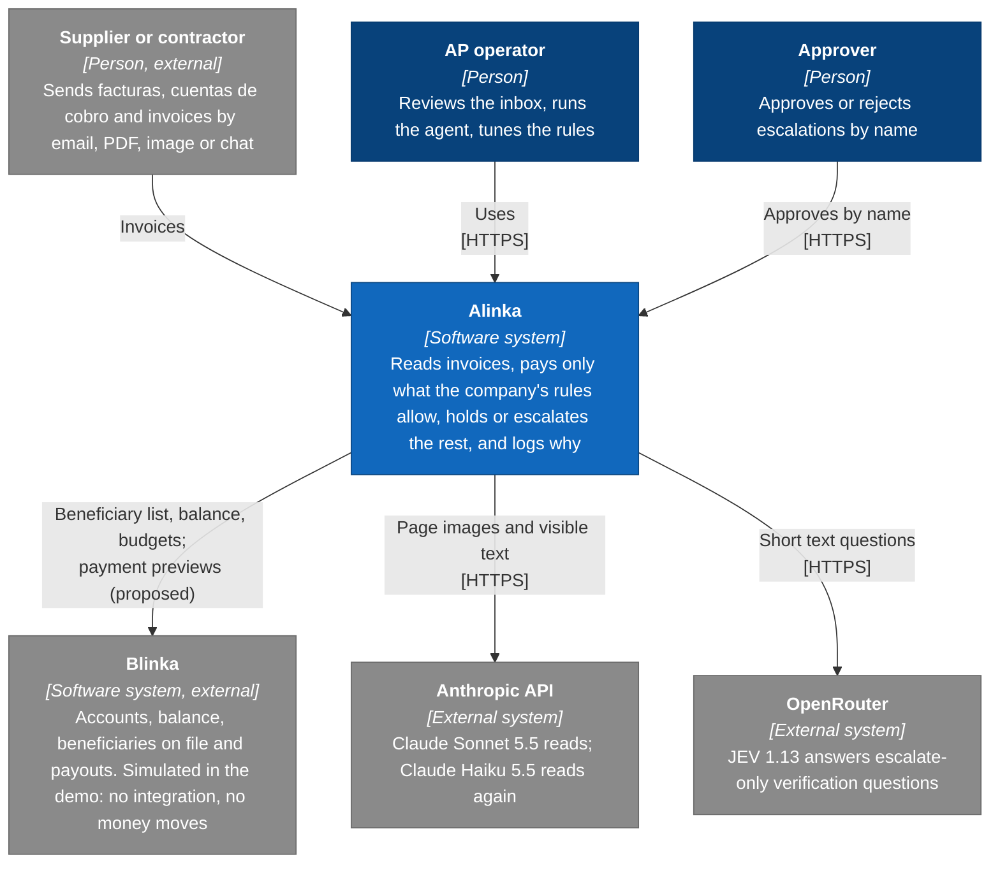
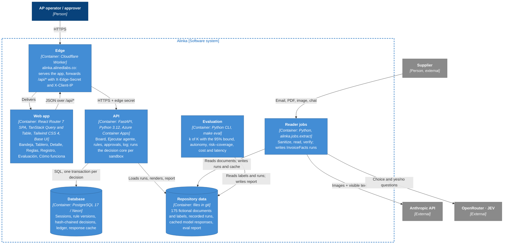
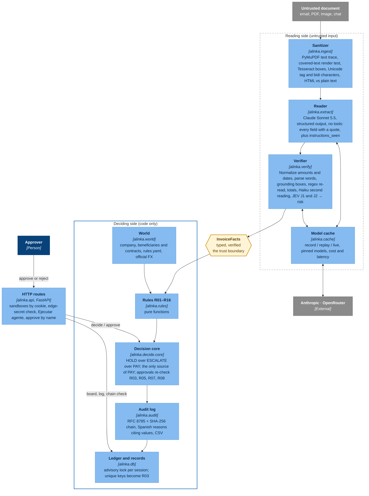

# Architecture (C4)

Alinka in three C4 levels: the system in its context, the containers inside it, and the components of the decision pipeline. The line that matters is the **trust boundary**: only typed `InvoiceFacts` cross from the reading side into the rules, and only the decision core can return PAY.

Legend: dark blue = person, blue = Alinka, light blue = component, grey = external. Solid arrows are calls or data flow; the trust boundary is the dashed box.

## Level 1 · System context

## Level 2 · Containers

## Level 3 · Components of the decision pipeline

**What the levels show**
- **Context:** Alinka sits between suppliers and the company's payment platform. It proposes payments to accounts already on file and moves no money.
- **Containers:** one origin, `alinka.alinedlabs.co`; the Worker joins the app and the API. Reading runs as batch jobs whose recordings everything else replays, so the API and the tests need no model keys.
- **Components:** the model sits on the untrusted side and has no tools. Verification can only raise the risk. Sixteen pure rules and one decision core decide, and the log explains every decision in Spanish.
